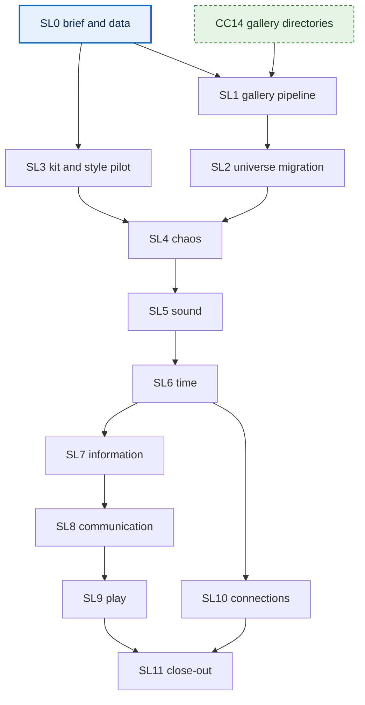

# creative coding: seven levels

dev plan for the art behind the seven reading tracks: 49 level images and 2 connection diagrams, all in one flat folder, `cc_pycairo/gen/seven_levels/`. seven of the 51 already exist as the cosmos series, so 44 are new.

**reading guide.** §0 is the current state and the queue. §1 says how the work fits this repo, including where it departs from the package. §2 is the order, which is the core of this plan. §3 is the tickets. §4 lists what must be corrected in the package's data. §5 is the checklist each ticket must pass. the log at the bottom records what has shipped.

---

## 0. state

- **next ticket:** SL0. nothing is built yet: no script, image or gallery change exists for this work.
- **done:** none.
- **scope of this repo:** SL0–SL11. the work in `eigenomar.com` is listed in its own document, [seven levels: eigenomar site actions](https://claude.ai/artifact/6TZ8CSu8qPxna9coRE7nBW), and is never implemented here.
- **source package:** the briefs and example data are in `/mnt/c/dev_ws/eigenomar/eigenomar/tmp/seven_levels/creative_coding_seven_levels_plan/`. that folder is gitignored in the other repo, so SL0 brings them here.
- **relation to the worlds plan:** this is a separate lane with one link: SL1 needs CC14, which built the gallery directories this work sits in and was done on 2026-11-05. no CC ticket needs an SL ticket.

**decided by the owner on 2026-11-04:**

1. **files are named by look, not by book.** a name comes from the image's color and form (§1), so the books neither gate the art nor appear in this repo's data.
2. **the 42 new track images are 4:5,** at 1600×2000. the seven universe images keep their existing shapes (1:1 to 16:9), which the site and the gallery both show without cropping.
3. **the cosmos group retires** behind aliases, so each piece appears only once. the migrated files take its place (SL2), and the old image files and URLs stay.
4. **the gallery shows the first track as cosmos.** this is a label only: its key and filenames stay `universe`, matching the site page.

### queue



green is done, blue is next, and the dashed box is a ticket in the worlds plan.

**one lane only:** SL0 → SL1 → SL2 → SL3 → SL4 → SL5 → SL6 → SL7 → SL8 → SL9 → SL10 → SL11.

**two lanes:** SL3 can run alongside SL1 and SL2, because it touches only `cc_pycairo/`. SL10 can run alongside SL7–SL9, because it needs only the graph drawing from SL6. the track order from SL5 on is a choice made for reuse, not a hard dependency, so a track can jump the queue if the site needs it, at the cost of rebuilding what it would have reused.

## 1. how the work fits this repo

the package said to adapt to the repo's conventions. this table is where that changed its suggestions. the choices are provisional, made 2026-11-04.

| topic | package says | this repo | this plan |
|---|---|---|---|
| root folder | `pycairo/` | `cc_pycairo/` | every path uses `cc_pycairo/`. the package's public URLs were already right |
| file names | `<track>_<NN>_<label>`, from the level's label | a stem is the item's id, and the build fails on duplicates | `<track>_<NN>_<color>_<form>`: a one-word color from the level's accent, then the image's main form, such as `time_03_orange_bloom`. the key `time.3` stays the stable id, and the registry maps it to the file. the two diagrams keep `connections_meta` and `connections_atomic`, which already name their form |
| scripts | one per track, with `--level` | one script, one image, flat in `cc_pycairo/`. the build links an image to its script through the literal path in `write_to_png("…")`, scans only the top level, and falls back to `<stem>.py` | one script per image, `cc_pycairo/<stem>.py`. a per-track script builds its path at runtime, which loses every source link, and would run to thousands of lines |
| parameters | `--width`, `--height` and `--seed` flags | constants at the top of each script | constants, `WIDTH, HEIGHT` and `SEED`. a flag could let a draft overwrite the canonical PNG |
| shared code | a small helper if needed | none. `glow` is copied into all 7 cosmos scripts | `cc_pycairo/seven_levels_kit.py`. a helper joins it at its second use (the rule in §2 of the worlds plan) |
| dependencies | add only when needed | stdlib, `cairo` and `noise`. no script in `cc_pycairo/` uses numpy | numpy only for grid simulations. it's installed, and the Cloudflare build never runs these scripts, so it's noted in the `requirements.txt` comment, not added as a requirement |
| registry | a `manifest.json` in the output folder | `.txt` manifests for order and titles, and generated files gitignored and built on deploy | a hand-written `seven_levels.json` at the repo root. the build derives `cc_pycairo/gen/seven_levels/manifest.json` from it, with each status read from the disk. that file is gitignored and served, like `gallery-data.js`. the registry holds no book or author, so changing a book touches only the site's reading page |
| gallery | one collection with track filters and overview cards | three levels since CC14: category, group and section | the `7-levels` group under `illustrations`, with a folder for each track and the two connection diagrams as images directly on its page. folders replace the filter chips and the overview cards. the universe track's folder is labeled cosmos |
| taxonomy | not covered | set once per series (Q1) | per track in the registry, because seven tracks span several worlds. this amends Q1 |
| alt text | semantic | the lightbox uses `item.title` | items get an `alt` field, kept out of `meta`, which is printed on tiles |

**measured on 2026-11-04:** all 7 cosmos scripts re-render byte-identical to their committed PNGs, which makes the universe migration safe. six of them took 0.7 to 7.9 seconds each in pure Python, so a full render at full size is fast enough to iterate on, and no preview mode is needed.

**size:** at the cosmos average of 2.1 MB, the 44 new images and the 7 copies add about 105 MB to the 519 MB in `cc_pycairo/gen/`. every file stays far under Workers' 25 MiB limit.

### the script shape

every script follows the cosmos shape: module-level code, run from the repo root, one literal output path. `SEED` is 100 × the track's position plus the level, so sound.3 is 303, using time 2, sound 3, information 4, chaos 5, communication 6, play 7.

```python
import math
import random
import cairo
from seven_levels_kit import glow, luminous, vignette

WIDTH, HEIGHT = 1600, 2000
SEED = 203
random.seed(SEED)

surface = cairo.ImageSurface(cairo.FORMAT_ARGB32, WIDTH, HEIGHT)
ctx = cairo.Context(surface)

# named palette constants, the model, then the drawing

surface.write_to_png("cc_pycairo/gen/seven_levels/time_03_orange_bloom.png")
print("Saved time_03_orange_bloom.png")
```

### the loop for one image

1. read the level's brief, including its interpretation note.
2. write `cc_pycairo/<stem>.py`, computing the model properly: a real solver for an equation, a correct code for the Hamming block.
3. run `python3 cc_pycairo/<stem>.py`, then look at the PNG at full size and at about 640 px, which is its gallery thumbnail.
4. check it against the brief: the accent, the concept, a safe margin for cropping, no large blocks of text, no Bézier-led construction.
5. if the finished image no longer fits its proposed name, rename the script and the file now. a name is fixed once it's on `main`.
6. run it again and confirm the bytes don't change.
7. fill in `alt` and `caption` in `seven_levels.json`, describing what the image shows. speculative or spiritual pieces say they are symbolic.
8. run `python3 build_gallery.py`.

## 2. the order

**the rules behind it:**

1. **plumbing before art.** the universe images already exist, so they prove the whole path from script to public URL, at almost no cost.
2. **agree the look on three images, not forty.** the pilot covers the three kinds of picture in this set: continuous lines, a computed field and a discrete diagram. rework found here costs three images.
3. **finish whole tracks.** the site publishes a track at a time, so seven images in one track are worth more than seven spread over all of them.
4. **order the tracks by reuse.** each track is placed where it can build on the last. that keeps most of the saving of working by technique, without leaving every track unfinished until the end.

**why chaos goes first:** six of its seven levels are one technique, trajectory integration, and it needs only two families in total. time, the first new track in reading order, would need four families and a one-off at once, before any of them had been tried.

### technique families

the 44 new images fall into eight families. "start from" is existing code worth copying from.

| family | what it is | images | start from |
|---|---|---|---|
| trajectory | integrate or iterate a system, then draw the path | 9 | `polyline` and `luminous` in `cosmos_forces.py` |
| field | solve on a grid, then draw contours | 4 | `contour` (marching squares) in `cosmos_resonance.py`, `bessel_table` in `cosmos_mandala.py` |
| rings | polar layouts: phases, onsets, spirals | 4 | nothing |
| signal | sampled signals, spectra, distribution bars | 5 | nothing |
| cells | bits, boards and recursive partitions | 7 | nothing |
| graph | nodes, arrows and layouts | 10, with the 2 diagrams | nothing |
| grammar | recursive rewriting into trees | 2 | nothing |
| one-off | a construction with one use | 3 | `chain` and `bone` in `cosmos_origin.py`, for communication.1 |

### how reuse grows

"reused" counts the images that use a family built in an earlier wave.

| wave | track | images | new families | reused |
|---|---|---|---|---|
| SL3, SL4 | chaos | 7 | trajectory, field | 0 of 7 |
| SL5 | sound | 7 | signal, rings | 3 of 7 |
| SL6 | time | 7 | graph | 4 of 7 |
| SL7 | information | 7 | cells, built in the pilot | 6 of 7 |
| SL8 | communication | 7 | grammar | 5 of 7 |
| SL9 | play | 7 | none | 6 of 7 |

### the full order

the stems for the 42 new levels are proposals, taken from each brief's visual idea and accent. the universe stems come from the finished images and are listed in SL2.

| # | asset | file stem | ticket | family | why here |
|---|---|---|---|---|---|
| 1–7 | universe.1 to universe.7 | see SL2 | SL2 | migrated | no new art, and it proves the pipeline |
| 8 | chaos.3 instability | `chaos_03_red_butterfly` | SL3 | trajectory | pilot: lines. starts the integrator |
| 9 | chaos.6 complexity | `chaos_06_violet_reef` | SL3 | field | pilot: field. starts the numpy grid solver |
| 10 | information.3 encoding | `information_03_violet_bitgrid` | SL3 | cells | pilot: discrete. furthest from the cosmos look, so it's the riskiest for the style |
| 11 | chaos.7 uncertainty | `chaos_07_gold_fan` | SL4 | trajectory | the same Lorenz system as chaos.3, with an ensemble |
| 12 | chaos.2 motion | `chaos_02_steel_ellipses` | SL4 | trajectory | the integrator, plus a phase-plane frame |
| 13 | chaos.1 order | `chaos_01_blue_vortex` | SL4 | trajectory | reuses that frame with a vector field |
| 14 | chaos.5 emergence | `chaos_05_turquoise_flock` | SL4 | trajectory | adds a boids step |
| 15 | chaos.4 nonlinearity | `chaos_04_orange_cascade` | SL4 | trajectory | an iterated map, drawn as a density raster |
| 16 | sound.1 vibration | `sound_01_ocean_ripples` | SL5 | field | the wave equation, on chaos.6's grid solver |
| 17 | sound.7 transcendence | `sound_07_gold_rosette` | SL5 | field | nodal contours, with `bessel_table` |
| 18 | sound.2 frequency | `sound_02_ice_strands` | SL5 | signal | starts the signal and spectrum plot |
| 19 | sound.4 rhythm | `sound_04_coral_wheels` | SL5 | rings | starts the ring layout |
| 20 | sound.3 harmony | `sound_03_violet_interlace` | SL5 | rings | the same rings, with ratios and beats |
| 21 | sound.5 perception | `sound_05_emerald_coil` | SL5 | rings | a log spiral, with filter responses from sound.2 |
| 22 | sound.6 emotion | `sound_06_rose_currents` | SL5 | trajectory | polylines and event markers |
| 23 | time.3 entropy | `time_03_orange_bloom` | SL6 | field | diffusion, on the same grid solver |
| 24 | time.1 change | `time_01_slate_trails` | SL6 | trajectory | advection through chaos.1's vector field |
| 25 | time.2 rhythm | `time_02_cyan_dials` | SL6 | rings | phase rings from sound.4 |
| 26 | time.7 eternity | `time_07_gold_spirals` | SL6 | trajectory | spiral sampling from sound.5 |
| 27 | time.4 relativity | `time_04_indigo_cone` | SL6 | one-off | Lorentz transforms on straight grids |
| 28 | time.5 causality | `time_05_copper_circuit` | SL6 | graph | starts nodes, arrows and routed polylines |
| 29 | time.6 timelessness | `time_06_silver_web` | SL6 | graph | the same nodes, placed by multidimensional scaling |
| 30 | information.2 signal | `information_02_cyan_static` | SL7 | signal | the plot from sound.2, with a noisy channel |
| 31 | information.4 entropy | `information_04_amber_bars` | SL7 | signal | distribution bars |
| 32 | information.7 reality | `information_07_silver_phasors` | SL7 | signal | those bars, plus phasors |
| 33 | information.1 difference | `information_01_graphite_mosaic` | SL7 | cells | recursive splits on the pilot's cells |
| 34 | information.5 computation | `information_05_cobalt_tape` | SL7 | cells | tape cells, plus a state graph from time.5 |
| 35 | information.6 intelligence | `information_06_teal_mesh` | SL7 | cells | Hopfield updates on the same cells |
| 36 | communication.5 interpretation | `communication_05_indigo_prism` | SL8 | signal | probability profiles from information.4 |
| 37 | communication.2 signals | `communication_02_copper_pulses` | SL8 | graph | arrows from time.5, carrying pulse sequences |
| 38 | communication.4 meaning | `communication_04_teal_twins` | SL8 | graph | two layouts of one graph |
| 39 | communication.6 connection | `communication_06_coral_threads` | SL8 | graph | edge weights over several steps |
| 40 | communication.7 understanding | `communication_07_gold_bridges` | SL8 | graph | two graphs with a matching |
| 41 | communication.3 language | `communication_03_violet_tree` | SL8 | grammar | starts recursive expansion into trees |
| 42 | communication.1 expression | `communication_01_ochre_figures` | SL8 | one-off | jointed figures, from `chain` and `bone` |
| 43 | play.1 curiosity | `play_01_green_trail` | SL9 | cells | a grid agent revealing a map |
| 44 | play.2 rules | `play_02_cobalt_maze` | SL9 | cells | a board under two rule sets |
| 45 | play.3 strategy | `play_03_amber_facets` | SL9 | cells | a payoff grid and its subdivisions |
| 46 | play.5 cooperation | `play_05_turquoise_pool` | SL9 | graph | coalition graphs |
| 47 | play.7 freedom | `play_07_gold_delta` | SL9 | graph | a state graph that opens out |
| 48 | play.6 imagination | `play_06_lavender_kingdom` | SL9 | grammar | rewriting rules from communication.3 |
| 49 | play.4 competition | `play_04_crimson_cells` | SL9 | one-off | Voronoi cells over several rounds |
| 50 | connections_meta | `connections_meta` | SL10 | graph | seven anchors and 21 links |
| 51 | connections_atomic | `connections_atomic` | SL10 | graph | a seeded force layout, the only new layout work |

## 3. tickets

sizes as in the worlds plan: **S** takes under an hour and **M** fills one session. in the "needs" column, a ticket ID is a hard dependency, and "after X" is only a choice of order. "site" names the action in the site document that the ticket unblocks once deployed.

| ID | ticket | size | needs | site | status |
|---|---|---|---|---|---|
| SL0 | brief and data into the repo | S | none | action 9 | todo |
| SL1 | gallery pipeline | M | SL0, CC14 | action 5 | todo |
| SL2 | universe migration | S | SL1 | action 7 | todo |
| SL3 | kit and style pilot | M | SL0 | none | todo |
| SL4 | chaos | M | SL2, SL3 | action 8 | todo |
| SL5 | sound | M | SL3, after SL4 | action 8 | todo |
| SL6 | time | M | SL3, after SL5 | action 8 | todo |
| SL7 | information | M | SL3, after SL6 | action 8 | todo |
| SL8 | communication | M | SL3, after SL7 | action 8 | todo |
| SL9 | play | M | SL3, after SL8 | action 8 | todo |
| SL10 | connections | M | SL0, SL1, after SL6 | action 10 | todo |
| SL11 | close-out | S | SL4–SL10 | none | todo |

### SL0 · brief and data into the repo · S

- **do:**
  - copy briefs 01–09 into `seven_levels_briefs/`, and add that folder to `.assetsignore`, since everything else committed is served.
  - write `seven_levels.json` from `assets-manifest.example.json`: tracks with position, gallery label, world, worlds, systems, concept and color, and levels with id, level, label, accent, stem, `alt` and `caption`, taking the stems from §2 and SL2. leave out `path`, `public_url` and `status`, which are derived, and `book` and `author`, which belong to the site's reading pages.
  - write `seven_levels_connections.json` from `connections.example.json`.
  - apply the corrections in §4.
- **done when:** both files parse, and the registry holds 49 levels and 2 connection diagrams.

### SL1 · gallery pipeline · M

- **do:**
  - point the `7-levels` group from CC14 at the registry, in the style of `collect_manifest_items`: registry order, and a missing file gives a warning and is skipped. that is what makes pending work safe.
  - give each level item its label as its title and its folder as `section`, leave the two diagrams without a `section`, put `track` and `level` in `meta`, and keep `alt` and `caption` as their own item fields. `gallery.js` uses `alt` and falls back to the title.
  - resolve taxonomy per track from the registry, and amend Q1 in the worlds plan.
  - validate in the build, exiting 1 on failure: unique ids, the naming rule in §1, and every connection endpoint exists.
  - write `cc_pycairo/gen/seven_levels/manifest.json` with status, dimensions and public URL. gitignore it, and keep the rule that a build which finds nothing new changes nothing.
  - update the README's "adding work", and add numpy to the comment in `requirements.txt`.
- **from CC14:**
  - the group reads `cosmos.txt` today, and its `section` field puts all seven pieces in the cosmos folder. drop that field when the registry starts setting `section` on each item. `collect_sections` already checks each item's value.
  - all seven folders are declared in `sections`, in the order of the ticket's tree, and only cosmos has a blurb. a folder's card and page show no blurb if it has none, so add them as tracks arrive.
  - the group's blurb says "cosmos is the first", and the page's subtitle is `group.directory`, today `cosmos.txt`. both need rewording here. cosmos's own blurb names `cosmos.txt` too.
- **done when:** the build is clean with no images present, the manifest lists all 51 as `planned`, and a test image shows up in its folder and flips to `generated`.

### SL2 · universe migration · S

- **do:**
  - add a second literal `write_to_png` to each of the 7 cosmos scripts, writing the new name from the table below, which replaces the one in brief 09. the scripts keep their names and URLs, and the build maps both outputs to the same script.
  - render them, and confirm each new file is byte-identical to its `gen/cosmos/` original.
  - fill in `alt` and `caption` for the seven.
  - replace the seven old items in the cosmos folder with the new files, so each piece appears once. add aliases so `#/worlds/cosmos_<name>` opens the new id, and update the README's example. CC14 already redirects `#/pycairo/cosmos`.
  - keep `cc_pycairo/gen/cosmos/` and `cosmos.txt` in place: the site's universe article links to those files until site action 7 ships.
- **done when:** the migration leaves the gallery's item count unchanged (7 out, 7 in), the 7 new URLs and the 7 old ones all return PNGs when deployed, and the old hash routes land on the right pieces.

| old file | new file |
|---|---|
| `cosmos_origin.png` | `universe_01_blue_horizon.png` |
| `cosmos_resonance.png` | `universe_02_turquoise_fireflies.png` |
| `cosmos_geometry.png` | `universe_03_violet_polyhedron.png` |
| `cosmos_spacetime.png` | `universe_04_indigo_mesh.png` |
| `cosmos_forces.png` | `universe_05_amber_orbits.png` |
| `cosmos_mandala.png` | `universe_06_magenta_mandala.png` |
| `cosmos_oneness.png` | `universe_07_gold_sphere.png` |

### SL3 · kit and style pilot · M

- **do:**
  - write `cc_pycairo/seven_levels_kit.py` with only what cosmos already repeats: `glow`, `mix`, `luminous`, `contour`, a background and a vignette.
  - render chaos.3, chaos.6 and information.3 at 1600×2000.
  - **owner review:** agree the background, glow strength, line weights, margins and how an accent is used. record the result here in §1.
- **done when:** the owner signs off the three images. from then on the kit is additive: a helper may be added, but changing one changes every image that uses it, so that needs a re-render and a review of all of them.

### SL4–SL9 · one track each · M

- **do:** work through the track's rows in §2, in order, using the loop in §1. move a helper into the kit at its second use. work on a branch per track and merge only when all seven images are reviewed, because anything on `main` is public at once.
- **done when:** the track's seven PNGs are in the folder, the deployed manifest shows them as `generated`, and the track's folder shows seven pieces in level order.
- **not here:** changing a shipped image to suit a later one, unless the owner asks.

### SL10 · connections · M

- **do:**
  - write `cc_pycairo/connections_meta.py`: seven anchors on a circle, all 21 links faint, and the 10 strong links from brief 08 emphasized.
  - write `cc_pycairo/connections_atomic.py`: a seeded force layout of 49 nodes in seven clusters, keeping each track's numeric order, with the six relation types told apart by stroke pattern as well as color.
  - both read `seven_levels_connections.json`, so the picture can't drift from the data.
- **done when:** both are deterministic and readable at full size, both show directly on the 7 levels page, and the atomic drawing stays legible rather than becoming a hairball.

### SL11 · close-out · S

- **do:**
  - re-render everything and confirm `git status` shows no change in `cc_pycairo/gen/seven_levels/`.
  - check that all 51 public URLs return PNGs.
  - update §1 of the worlds plan (repo facts, 308 items) and the README.
- **done when:** the acceptance tests in brief 09 that belong to this repo pass.

## 4. corrections to the package's data

checked by script on 2026-11-04. the good news first: tracks, nodes, 21 meta pairs and 49 atomic edges are all present, with no dangling or duplicate edges, and labels, books and authors match the reading documents on all 49 levels.

| # | problem | fix | ticket |
|---|---|---|---|
| 1 | all 51 `path` values and `base_path` start with `pycairo/` | drop them, since they're derived from `cc_pycairo/` | SL0 |
| 2 | the 6 journeys are only in brief 08, not in the data | add a `journeys` list to the connections file | SL0 |
| 3 | 9 of the journeys' 27 steps cross tracks with no bridge in the data (10 more stay inside one track) | give each step its own reason in `journeys`, leaving the 49 curated edges alone. the owner may prefer to change the journeys | SL0 |
| 4 | information/chaos is one of the 10 emphasized meta links, but has no atomic bridge. universe/play, time/communication and time/play have none either | the owner decides whether to add a bridge for information/chaos. brief 08 asks for exactly 49, so that needs its count changed | SL0 |
| 5 | no track has a signature color, though brief 08 expects one and accents repeat across tracks (violet 4 times, turquoise 3) | choose seven colors for the registry, and confirm them at the pilot review | SL0 |
| 6 | the manifest's filenames, and the naming contract and migration table in brief 09, use level labels. the manifest also carries `book` and `author` | use the stems in §2 and SL2, and drop both fields | SL0 |
| 7 | 14 of the 35 connected pairs are mirrored, so 49 directed edges are only 35 lines | draw 35 lines, marking the mirrored ones as two-way. keep all 49 in the data, since each direction has its own question | SL10 |

## 5. definition of done

**every ticket:** §5 of the worlds plan applies, including updating the ticket table, the queue diagram and the log here.

**every image, in addition:**

- running its script twice gives identical bytes.
- it is written to `cc_pycairo/gen/seven_levels/`, with no per-track folder, under a name that follows §1. the name can change only before its first merge to `main`.
- its model is computed, not imitated, and `curve_to` isn't the main construction.
- it matches its level's concept and accent, and honors the interpretation note.
- `alt` and `caption` are filled in, in lowercase with no em dashes.
- no placeholder or fake image is ever committed. a missing image stays missing, and shows as `planned`.

---

## log

| date | ticket | note |
|---|---|---|
| 2026-11-04 | none | plan written from the seven levels package. the repo and the site were read and left unchanged, apart from this file and a pointer in the worlds plan. the cosmos scripts were re-rendered outside the repo to confirm they reproduce byte for byte, and the package's data was checked by script (§4) |
| 2026-11-04 | none | the owner settled the three decisions in §0: files are named by look rather than by book, the new track images are 4:5, and the cosmos group retires behind aliases. all 49 level names are now in §2 and SL2 |
| 2026-11-04 | none | the 7 levels work now sits in the gallery directories from CC14: one folder per track plus meta and atomic, replacing the track filter. SL1 needs CC14. the first track shows as cosmos, as a label only |
| 2026-11-04 | none | the owner changed meta and atomic from folders to images directly on the 7 levels page, so 7 levels has seven folders and two images |
| 2026-11-05 | none | CC14 is done, so SL1 now waits only on SL0. the `7-levels` group exists with cosmos as its one folder, and SL1 gained **from CC14** notes |
