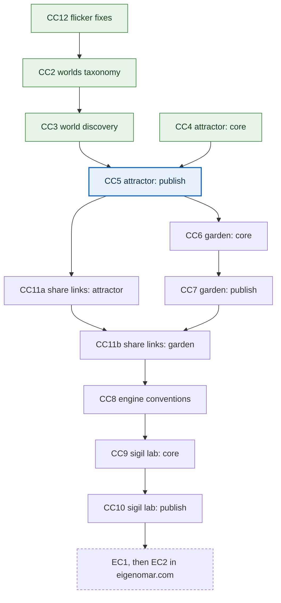

# creative coding: worlds and engines

dev plan for growing `creative_coding` (this repo) from a gallery grouped by toolkit into a collection of interactive generative engines. each engine explores one visual language, mathematical system, or idea, and visitors can watch it, steer it, or build with it.

**reading guide.** §0 is the current state and the queue of tickets to pick up next. §1 describes the repo as it is. §2 and §3 are the rules and vocabulary that every ticket uses. §4 is the work. §5 is the checklist each ticket must pass. §6 records the design decisions (provisional, made 2026-11-03). §7 is the backlog. appendix A is work for a different repo. the log at the bottom records what has shipped.

**external references.** D2, D3, D5, D6 and L1–L8 are defined in the `eigenomar.com` dev plan, not in this repo.

---

## 0. state

- **next ticket:** CC5 (step 3), whose needs, CC3 and CC4, are both done.
- **done:** CC1, CC2, CC3, CC12 (2026-11-03), CC4 (2026-11-05).
- **milestone 1:** CC5, CC7 and CC10 are published, giving three engines in three worlds (dynamical, organic, mystic), built on the CC2–CC3 taxonomy.
- **scope of this repo:** CC1–CC14 (the owner approved CC12 on 2026-11-03 and asked for CC13 and CC14 on 2026-11-04). EC1–EC2 and the changes to the main plan (appendix A) belong to `eigenomar.com` and are never implemented here.
- **repos:** `creative_coding` is the home of every engine, algorithm, renderer, control and gallery page, and no new repo is needed. `eigenomar.com` presents the project under art and links to it. `gallery.eigenomar.com` is served from this repo (see §1).
- **tracking link:** [this file on GitHub](https://github.com/eigenomarksamy/creative_coding/blob/main/worlds_and_features-dev_plan.md) is the one link for following this work from other repos, and `eigenomar.com`'s `dev-plan.md` uses it. it shows what is pushed to `main`. keep no copy of this plan anywhere else, because a copy can drift.
- **seven levels:** the static pycairo art for the seven reading tracks is a separate lane with its own plan, `seven_levels-dev_plan.md` (SL0–SL11). no CC ticket needs it, but its pipeline ticket, SL1, needs CC14.
- **long-term direction:** independent engines connected by their concepts, whose systems and interactions might later be combined without losing what makes each one distinct. there is no general composer until the gates in §7 are met.

**open questions for the owner** (raised by CC1):

1. ~~should this plan stay public?~~ no: `.assetsignore` excludes `*dev_plan.md` since 2026-11-03, so the plan leaves the site on the next deploy. it is still readable in the public GitHub repo. `CLAUDE.md` and `.claude/` followed on 2026-11-05, when the owner asked for them to be excluded too.
2. ~~approve CC12?~~ approved on 2026-11-03 and done.
3. ~~add `node --test &&` to the start of the Cloudflare build command?~~ no, decided by the owner on 2026-11-05. tests stay local, so run `node --test` before pushing.

### queue

take the earliest step whose needs are met. tickets joined by ∥ can run at the same time in separate branches or worktrees, because they touch different files. tickets joined by → run in that order, ideally in the same session. when lanes run in parallel, each one edits only its own rows in §4 and appends its own log line, and a conflict in this file is resolved by keeping both sides.



green is done, blue is next, and the dashed box is work in another repo.

| step | tickets | touches | why here |
|---|---|---|---|
| 1 | (CC12 →) CC2 ∥ CC4 | CC12: the three `canvas/*.html` scripts. CC2: `build_gallery.py`, plus a meta block in each of the three sketch pages. CC4: the new folder `canvas/strange-attractor/` and `.assetsignore` | CC2 is small and unblocks CC3. CC4 needs only CC1, shares no file with CC2, and is the riskiest ticket, so it starts early. CC12, if approved, takes under an hour and removes flicker from the live site |
| 2 | CC3 (∥ CC4 if it's still running) | `gallery/`, `build_gallery.py` | follows CC2 directly, while the item model and the facet code are still fresh |
| 3 | CC5 | `build_gallery.py` (sketch scan), `canvas/strange-attractor/` | the lanes join: CC5 needs CC3 and CC4. coming straight after CC4 keeps the engine fresh for the polish work, which is most of CC5 |
| 4 | CC11a ∥ CC6 | `canvas/strange-attractor/` ∥ the new folder `canvas/artificial-garden/` | share links and export go into the attractor while its parameters are fresh. CC6 starts after CC5 has shown what publishing needs, and gives every parameter a range from the start, so CC11b has nothing to retrofit |
| 5 | CC7 | `canvas/artificial-garden/`, `build_gallery.py` if any metadata is new | the garden is published |
| 6 | CC11b → CC8 | `canvas/artificial-garden/`, then `canvas/lib/` and both engines | CC11b copies CC11a's pattern. CC8 runs straight after it, while both implementations are fresh, and its gate is met there |
| 7 | CC9 → CC10 | the new folder `canvas/sigil-laboratory/`, `build_gallery.py` if any metadata is new | the sigil lab is built on CC8's conventions, which completes milestone 1. then EC1 in `eigenomar.com` |

**one lane only:** (CC12 →) CC2 → CC3 → CC4 → CC5 → CC11a → CC6 → CC7 → CC11b → CC8 → CC9 → CC10.

the queue changes the original order in two ways. CC11 is split, so share links reach each engine right after it ships instead of being added to both later (Q6, amended). CC12 is new and optional. every hard dependency in §4 still holds.

**any time:** CC13 touches only the gallery footer and needs nothing, so it fits between any two steps. it stays out of the steps and the diagram above.

**before SL1:** CC14 needs nothing either, and it also stays out of the steps and the diagram, but the seven levels pipeline builds on it. it rewrites `CATEGORIES` and the routes in `gallery.js`, so don't run it at the same time as CC5 or SL1.

## 1. repo facts

first observed on 2026-11-03 while restructuring this plan, then confirmed, corrected and extended by CC1 the same day. keep this section up to date. findings that affect a single ticket are written into that ticket as **from CC1** notes.

### 1.1 architecture and conventions

| area | fact | what it means for the plan |
|---|---|---|
| stack | static site with no package.json, bundler, test runner or type checker. the only build step is `python build_gallery.py`, which needs Pillow. locally that is Python 3.10 with Pillow 10.3, and node v20.5 | in §5, "tests, type checks and build pass" means the build runs clean and any tests a ticket adds pass |
| repo contents | 431 tracked files: 54 pycairo scripts, 91 top-level pygame scripts with `shapes/` and `utils/` helpers, their committed renders (519 MB in `cc_pycairo/gen/` and 70 MB in `cc_pygame/gen/`), the 3 canvas sketches, the gallery (`gallery/index.html`, `gallery.js`, `gallery.css`), `build_gallery.py`, two manifests (`12.txt`, `cosmos.txt`) and the deploy config | renders are committed and served as they are. thumbnails are the only processed assets |
| build pipeline | `CATEGORIES` → `build_gallery.py` → `gallery/gallery-data.js` (which sets `window.GALLERY_DATA`) and `gallery/thumbs/<category>/<stem>.jpg` (640 px, JPEG quality 80; a piece longer than 2:1 gets a bigger thumbnail, so the 2:1 window its tile crops to still gets 640 px, e.g. 320×2560 for the 375×3000 `jpger_77`). thumbnails rebuild only when the source is newer, unless `--force` is given. stale ones are pruned, and the data file is rewritten only when something besides the build time changed. metadata errors exit with code 1 before anything is pruned or written. today: 264 items in 3 categories and 6 groups, and a data file of 289 KB (14 KB gzipped) | every gallery change goes through this one script. keep the rule that a build which finds nothing new changes nothing |
| build output | `gallery/gallery-data.js` and `gallery/thumbs/` are both gitignored | run the build before viewing or deploying |
| deploy | Cloudflare Workers static assets (`wrangler.jsonc`). the whole repo is served at `gallery.eigenomar.com`, and `_redirects` sends `/` to `/gallery/`. the Cloudflare build command runs `pip install` and `build_gallery.py` and nothing else, and every push to `main` redeploys | this repo is the gallery. tests don't run on deploy, by the owner's choice (§0), so run `node --test` before pushing |
| what is published | every file not listed in `.assetsignore`. that includes `README.md`, `build_gallery.py`, the scripts and manifests (the lightbox links to the scripts). this plan is excluded by `*dev_plan.md`, tests by `*.test.js`, and `CLAUDE.md` and `.claude/` by name. the largest file is 18.8 MiB, under Workers' 25 MiB limit per file | anything merged to `main` is public at once. an engine core can be reached at its URL before its publish ticket adds it to the gallery |
| item shape | category → group → item. every item has `id`, `kind` (`image` or `sketch`), `title`, `full`, `source`, `sourceLabel`, `bytes`, `meta` and `taxonomy`, and images also have `thumb`, `width` and `height`. `meta` holds `scene`, `palette` and `variant` for render engine files, `no` and `file` for manifest entries, and is `{}` everywhere else. `taxonomy` (since CC2) is `{world, worlds, systems, interactions, modes, concept}`, or `null` for an unclassified piece, and the vocabulary is at `GALLERY_DATA.vocabulary` | the taxonomy stays out of `meta` (Q7) |
| item ids | an id is the file stem, and since CC2 the build fails when two items anywhere in the gallery share one. every engine page (`canvas/<id>/index.html`) would get the stem `index` | CC5 takes an engine's id from its folder name |
| how `meta` is shown | `metaLine` in `gallery.js` puts every `meta` value that isn't already in the title onto the tile, and the lightbox lists every `meta` key with its value | taxonomy stored in `meta` would change tiles and captions, with lists printed as `a,b`, so it gets its own field (Q7) |
| current taxonomy | `CATEGORIES` in `build_gallery.py` groups pieces by toolkit: pygame, pycairo (12., sketches, render engine, cosmos) and canvas | worlds are a new axis that cuts across toolkits |
| current filtering | a group can declare `facets` (keys into `item.meta`), and `collect_facets` turns them into chips. only the render engine group has any. filters live in hash params, e.g. `#/pycairo/render-engine?scene=fault line`. `collect_facets` keeps a facet only if it has more than one value, and collects values in a Python set, so a list value makes the build fail. since CC3, `gallery.js` filters on lists: the facet keys `world`, `system` and `interaction` read `item.taxonomy`, `world` matches primary or secondary worlds, and the worlds view builds its chips (with counts) from `GALLERY_DATA.vocabulary` in the browser. `collect_facets` was left as it is, because no group declares a list facet | a toolkit group that wants world chips declares a `world` facet, which needs `collect_facets` taught about lists first |
| curation | a manifest (`position: title: stem` per line, `#` comments) sets the order and titles of a series. `exclude_manifests` keeps a curated piece out of its directory group, so it appears once | the worlds view must also show each piece once |
| source links | the build links an image to the script whose `write_to_png("…")` or `image.save(…, "…")` names it, and otherwise guesses `<stem>.py`, or `pnger_NN.py` for `jpger_NN.jpg`. only `cc_pycairo/gen/output.png` has no source | none |
| routing | `gallery/gallery.js` uses hash routes (`#/`, `#/<category>`, `#/<category>/<group>`, filters as query params) so the gallery works when opened from `file://`. since CC3 there are also `#/worlds` (every piece, filterable) and `#/worlds/<id>` (one piece with its classification and related pieces), and the lightbox links to the piece page. the build refuses a category with the id `worlds` | the gallery must keep working from disk. every piece has a stable gallery URL, and a sketch also keeps its file URL |
| live sketches | there are 3: `canvas/gol.html`, `canvas/snake1.html` and `canvas/snake2.html`. each is a single file of inline JS on Canvas 2D using unseeded `Math.random`. **none reads any input**: no pointer, touch or keyboard handling, so they are autonomous, not interactive. `gol.html` runs one generation per `requestAnimationFrame`, so its speed follows the display's refresh rate, and the snakes step on a 100 ms `setTimeout`. all three restart when the window is resized. until CC12, `gol.html` gave every live cell a new random color on every frame, and `snake2.html` did the same to every segment on every step, so both flickered. since CC12, `gol.html` steps 30 generations a second on any display and colors each cell by its position, and `snake2.html` keeps each segment's hue. all three slow down under reduced motion (4 generations a second, 400 ms steps) and stop while the tab is hidden or the canvas is out of view. the title comes from `<title>` and `meta` is `{}`. since CC2, each page also carries a meta block with its classification | none of the three is interactive. strange attractor is the first piece that is (CC4), and the gallery doesn't list it until CC5 |
| how sketches are found | `collect_sketch_items` scans only the top level of `canvas/*.html` | engines live in folders (Q5), so CC5 extends the scan to `canvas/<id>/index.html` |
| how sketches are shown | the gallery shows a ▶ poster, clicking it loads the sketch in an `<iframe>` with a `title`, and "open ↗" links straight to the file. nothing pauses an iframe that has scrolled out of view, several can run at once, and an iframe is torn down only when a route change clears the view | each sketch already has a stable direct URL (`/canvas/<name>.html`). engines must pause themselves when hidden or out of view (§2) |
| static renders | 261 images from `cc_pycairo/` and `cc_pygame/`, none of them interactive | they get worlds, set once per series (Q1) |
| JS style | `gallery.js` is an ES5 IIFE using `var` and no modules. the canvas sketches use ES2015+ (`const`, arrow functions, template literals, spread) in inline classic scripts | gallery code stays ES5. engine code may use ES2015+ in classic scripts, never modules (§2, works from disk) |
| theming | `gallery.css` is dark by design (`color-scheme: dark`), with no light/dark switch. since CC3, smooth scrolling and the card hover lift run only under `prefers-reduced-motion: no-preference`, and nothing else in the chrome moves | the §5 theme check doesn't apply yet |
| accessibility | tiles are buttons with alt text and chips are links, so both work from the keyboard. the lightbox is a modal dialog with Escape and arrow keys that gives focus back when it closes, and since CC3 it keeps Tab inside itself. a chip used to filter gets focus back after the view reloads, and running a sketch moves focus into its iframe. the old sketches' canvases have no label or text alternative, and strange attractor's has one since CC4 | each engine's publish ticket checks its canvas label |
| mobile | the gallery grids reflow with `minmax`, capped at the page width since CC3 (the image tiles are justified flex rows instead since 2026-11-03: every image in a row has the same height, around `clamp(130px, 18vw, 230px)`, and anything longer than 2:1 is cropped to 2:1 in its tile, with `TILE_MAX_ASPECT` kept equal in `gallery.js` and `build_gallery.py`), so nothing scrolls sideways at 320 px. the nav wraps, and the lightbox arrows move to the bottom under 640 px, with no swipe. the old sketches fill the window at CSS-pixel resolution (no `devicePixelRatio`) and have no touch input | engines scale their canvas to `devicePixelRatio` and handle touch themselves, as strange attractor does since CC4 |
| local tools | node v20 is installed. `node --test` finds `canvas/strange-attractor/sim.test.js` through its default patterns, so new engines need no setup | `node --test` is the test runner, with no dependencies (Q4) |

### 1.2 existing work

the slugs are from §3. CC1 suggested the worlds and CC2 set them on 2026-11-03: these are the values `build_gallery.py` and the sketch pages now declare. CC2 differs from CC1's suggestions in four places: `gol.html` has no secondary world, `snake2.html` is abstract with glitch as a secondary, the pygame series adds abstract and perceptual for its moiré rings and op-art grids, and the snakes use the new system `agents`.

| piece | kind | count | look | system | interaction | world (secondary) |
|---|---|---|---|---|---|---|
| `canvas/gol.html` "Game of Life - Dark Mode" | live | 1 | full-window grid of 10 px cells on black, each position in its own random dark hue (which changed every frame until CC12) | cellular-automata: Conway's B3/S23 from a 30% random fill, with hard edges | autonomous, observe only | organic |
| `canvas/snake1.html` "Auto-Moving Snake" | live | 1 | 20 px grid, a blue-to-violet body, red food | one agent on a random walk, with a 10% chance to turn on each step, that restarts when it collides: agents | autonomous, observe only | abstract |
| `canvas/snake2.html` "AI Snake with Random Colors" | live | 1 | the same grid, each segment in its own random hue (re-colored every step until CC12), new food color on each meal | one greedy agent that moves along x and then y toward the food: agents | autonomous, observe only | abstract (glitch) |
| pycairo render engine (`render_engine.py`, group render-engine) | series | 126 | 7 scenes × 6 palettes × 3 variants at 2800×1600: gradient "pressure" blobs, Bézier brush lines that follow a flow angle around the blobs, dust, rings and particles | noise-fields, procedural-geometry. the only parameterized generator in the repo | static | abstract (fluid) |
| pycairo 12. | series | 13 | a curated set of Bézier brushwork, textures, flow fields and mycelium under poetic titles | noise-fields, recursive-growth | static | abstract (organic, fluid) |
| pycairo sketches | series | 34 | the rest of the pycairo one-offs: mandalas, flow fields, neural and mycelium blooms, glitch symmetry, textures, landscapes | noise-fields, procedural-geometry, recursive-growth | static | abstract (organic, geometric). the series varies most, so it is the first candidate for per-image overrides |
| pycairo cosmos | series | 7 | mathematical models (spiral galaxy, coupled oscillators, Platonic solids, curved spacetime, field lines, drum modes, spherical harmonics), each in one hue family with glows | oscillators, procedural-geometry | static | cosmic (geometric, mystic) |
| pygame sketches | series | 81 | numbered studies of shapes and polar math, each drawn once and saved as a JPG | procedural-geometry | static | geometric (abstract, perceptual) |

### 1.3 capabilities this plan asks for

| capability | exists today | gap | built by |
|---|---|---|---|
| parameters | `render_engine.py` is configured with module constants (which scenes and palettes, variants per palette, hue shift ranges), and the other scripts hardcode their values. the old sketches have only constants such as `cellSize`. since CC4, `PARAMS` in strange attractor's `sim.js` gives every parameter a default and a range, `clampParams` enforces them, and the page has sliders for them | only one engine has them so far | CC4 (done), CC6 |
| presets | `render_engine.py` has 6 named palettes and 7 named scenes (blob and line counts, sizes, segment lengths and so on). manifests choose and order pieces, so they are not presets. since CC4, `PRESETS` in strange attractor's `sim.js` has 4 named parameter sets | only one engine has them so far | CC4 (done), CC7, CC10 |
| seeds | `render_engine.py` derives a geometry seed and a separate color seed for each render from `BASE_SEED = 42`, and 22 other pycairo scripts seed `random` with a fixed value. the other 31 pycairo scripts, all 91 pygame scripts and all 3 sketches are unseeded. since CC4, strange attractor's `sim.js` has a mulberry32 generator, with separate geometry and color streams from one seed | Python's Mersenne Twister can't be reproduced in the browser, so no existing render can be rebuilt there. the generator stays in the engine until CC8 | CC4 (done), then CC8 |
| animation lifecycle | `requestAnimationFrame` in `gol.html` and `setTimeout` in the snakes, all restarting on resize. since CC12 they idle when hidden or out of view (`visibilitychange` and `IntersectionObserver`) and slow down under reduced motion. in the gallery, an iframe starts on click and goes away on a route change | the old sketches have no pause or reset control and no explicit teardown, and their lifecycle code is copied into each page, not shared. since CC4, strange attractor has pause, reset, and a teardown on `pagehide` | CC4 (done), CC5, then CC8 |
| image export | the Python scripts' whole output is a PNG or JPG on disk | nothing in the browser (no `toBlob` or `toDataURL`) | CC11a, CC11b |
| share links | gallery views, with route and filters in the hash, and since CC3 a page per piece (`#/worlds/<id>`) | no state in any sketch URL | CC11a, CC11b |
| saved settings | none (no `localStorage`) | none needed until visitor presets (§7, parked) | none |
| metadata | since CC2, every piece carries its world, systems and concept in `item.taxonomy`, alongside the filename fields for render engine images, `no` and `file` for manifest entries, and `<title>` for sketches | none | CC2, done |
| mobile interaction | gallery grids reflow, and since CC4 strange attractor takes taps and scales to `devicePixelRatio` | none of the old sketches has touch input or `devicePixelRatio` scaling, and no engine has been tried on a real phone | CC5, CC7, CC10 |
| tests | since CC4, `node --test` runs `canvas/strange-attractor/sim.test.js` | they run locally only, by the owner's choice (§0, question 3), and the pages have no committed tests | CC4 (done) |

## 2. constraints

these apply to every ticket. text in parentheses says how a rule applies in this repo.

- **minimal shell, rich insides.** the gallery interface stays restrained, while individual engines can be intricate, colorful and computationally expressive.
- **concept before aesthetics.** each engine investigates an idea, such as causality, emergence, perception, entropy or infinity, rather than only producing an attractive pattern.
- **reuse after the second use.** build one engine completely before extracting anything shared, and don't build a framework early.
- **independent experiences.** each published engine has a stable URL and runs without loading any other experiment (each engine is its own folder, `canvas/<id>/`, with `index.html` as its page).
- **deterministic where possible.** the same seed and parameters give the same initial state.
- **exploration without instruction.** a visitor understands the basic interaction within seconds. advanced controls are available but stay out of the way.
- **accessible by design.** support reduced motion, pause and reset, keyboard use and responsive canvases, give alternatives to anything that depends on audio, and never flash rapidly.
- **bounded performance.** scale workloads to the device, pause when the engine is hidden or off-screen, and release resources on teardown (here that means the tab is hidden, the iframe is removed, or the visitor leaves the page).
- **local-first.** no accounts and no backend. saved settings stay on the visitor's device.
- **preserve existing work.** audit before replacing structures, adding dependencies or rebuilding features. existing URLs and routes keep working.
- **works from disk.** this rule comes from §1, not from the original guardrails. the gallery opens from `file://`, and Chromium blocks ES-module imports there, so shared JS must be loaded as classic scripts or inlined.

## 3. vocabulary

### worlds

a world is an experiment's artistic identity. worlds are categories for discovery, not separate code architectures. each experiment has one primary world and any number of secondary worlds, and it appears once under every world it belongs to, without being duplicated.

| slug | identity | concepts |
|---|---|---|
| abstract | expressive, nonrepresentational compositions | chaos, emotion, entropy |
| geometric | patterns, symmetry, transformations, fractals | order, repetition, precision |
| mystic | sigils, celestial diagrams, symbolic structures | ritual, symbolism, transcendence |
| mechanical | gears, linkages, kinetic sculptures | causality, interdependence, rhythm |
| organic | growth, branching, evolving organisms | life, adaptation, emergence |
| fluid | liquid motion, turbulence, diffusion | flow, transformation, continuity |
| cosmic | orbits, gravitational systems, celestial structures | scale, infinity, spacetime |
| glitch | distortion, feedback, digital corruption | instability, noise, fragmentation |
| typographic | generative lettering, glyphs, procedural poetry | language, meaning, communication |
| perceptual | optical illusions, moiré patterns, impossible forms | ambiguity, perception, paradox |
| dynamical | attractors, phase spaces, nonlinear simulations | determinism, complexity, chaos |
| topographic | generative terrain, contours, imaginary landscapes | space, geography, formation |

### composition model

an experiment is described along three independent dimensions: its **world** (how it looks and feels), its **system** (the rules that drive it) and its **interaction** (how the visitor influences it). for now this is only a convention for metadata and design. a general-purpose composer is parked (§7).

CC2 finalized these slugs on 2026-11-03 and added `agents`. the canonical lists are the constants at the top of `build_gallery.py`.

| system slug | meaning |
|---|---|
| particle-fields | particle fields and flocking |
| attractors | attractors and dynamical systems |
| cellular-automata | cellular automata |
| reaction-diffusion | reaction-diffusion |
| recursive-growth | recursive growth and L-systems |
| oscillators | oscillators and coupled systems |
| procedural-geometry | procedural geometry |
| noise-fields | noise fields and turbulence |
| constraints | physical constraints and linkages |
| image-feedback | image transformations and feedback |
| agents | autonomous agents following simple rules (added by CC2 for the snakes) |

| interaction slug | meaning |
|---|---|
| pointer | pointer attraction and repulsion |
| gesture-drawing | gesture drawing |
| touch-drag | touch and drag |
| parameter-manipulation | parameter manipulation (CC2 chose this over `parameter-mutation`) |
| rule-mutation | rule mutation |
| placement | placing obstacles or resources |
| sound-input | sound and rhythm input |
| autonomous | autonomous evolution |

**modes.** declare only the modes that give meaningful behavior:

- `observe`: the system evolves on its own, with optional parameter controls.
- `intervene`: the visitor disturbs or redirects the system.
- `compose`: the visitor builds patterns, structures or rules with the engine.

**example compositions** (world + system + interaction):

- mystic + particle-fields + gesture-drawing: procedural sigils that dissolve into constellations.
- mechanical + oscillators + sound-input: a kinetic machine that responds to rhythmic patterns.
- organic + cellular-automata + placement: an artificial ecosystem the visitor influences indirectly.
- cosmic + attractors + parameter-manipulation: a miniature universe whose trajectories change with its physical constants.

### metadata (Q1, Q2, Q7)

the vocabulary (the worlds and the tags above) lives as Python constants in `build_gallery.py`. the build rejects unknown values and passes the vocabulary into `gallery-data.js`.

**engines and live sketches** carry a JSON block in their own page. the build reads it, and the page can read it to show its own title and concept, which also works from disk:

```html
<script type="application/json" id="meta">
{
  "id": "strange-attractor",
  "title": "strange attractor",
  "world": "dynamical",
  "worlds": ["abstract", "geometric"],
  "systems": ["attractors", "particle-fields"],
  "interactions": ["parameter-manipulation", "pointer"],
  "modes": ["observe", "intervene"],
  "concept": "determinism and chaos"
}
</script>
```

`world` is the one primary world, `worlds` lists optional secondary worlds, and `concept` is a short line on what the piece explores. live sketches must have `interactions` and `modes`. `id` and `title` are optional: `id` must match the file name, and `title` overrides `<title>`.

the build resolves every piece's fields into `item.taxonomy`, filling in empty lists and a `null` concept. a piece that declares nothing is unclassified: it builds with `taxonomy: null` and a warning. anything malformed or outside the vocabulary fails the build with exit code 1.

**image series** set the same fields once on their group in `CATEGORIES`, and every image in the group inherits them. `interactions` and `modes` don't apply. per-image overrides can come later if a series needs them.

```python
{
    "id": "cosmos",
    # ...existing fields...
    "world": "cosmic",                 # the real values since CC2
    "worlds": ["geometric", "mystic"],
    "systems": ["oscillators", "procedural-geometry"],
    "concept": "the universe as mathematical structure",
}
```

---

## 4. tickets

sizes: **S** takes under an hour and **M** fills one session. anything larger is split before work starts. in the "needs" column, a ticket ID is a hard dependency, and "after X" is only a choice of order.

| ID | ticket | size | needs | status |
|---|---|---|---|---|
| CC1 | repository and gallery audit | S | none | done |
| CC2 | worlds taxonomy and metadata | S | CC1 | done |
| CC3 | world-based gallery discovery | M | CC2 | done |
| CC4 | strange attractor: core | M | CC1 | done |
| CC5 | strange attractor: publish | M | CC3, CC4 | todo |
| CC6 | artificial garden: core | M | after CC5 | todo |
| CC7 | artificial garden: publish | M | CC6 | todo |
| CC8 | reusable engine conventions | M | CC5, CC7, CC11a, CC11b | todo |
| CC9 | sigil laboratory: core | M | CC8 | todo |
| CC10 | sigil laboratory: publish | M | CC9 | todo |
| CC11a | share links and image export: strange attractor | S | CC5 | todo |
| CC11b | share links and image export: artificial garden | S | CC7, CC11a | todo |
| CC12 | flicker and lifecycle fixes for the three old sketches | S | CC1 | done |
| CC13 | footer button to eigenomar.com | S | none | todo |
| CC14 | gallery directories | M | none | todo |

**order:** the queue in §0 sets the order, and EC1 → EC2 in `eigenomar.com` follow it. CC4 needs only CC1, so it runs alongside CC2–CC3. CC11a and CC11b both come before CC8, so that share links and export exist in two engines before anything is extracted (Q6).

### CC1 · repository and gallery audit · S

- **do:**
  - inspect the repo structure, rendering technologies, how experiments are organized, routing and deployment. §1 is a first pass.
  - list the existing engines with the visual style, system and interaction of each.
  - check what exists for parameters, presets, seeds, animation lifecycle, export and mobile interaction.
  - confirm the deployment target. this is already answered in §1: the repo deploys to `gallery.eigenomar.com`.
  - record which proposed capabilities already exist and which are genuinely missing.
  - document the current architecture and conventions.
- **output:** an updated §1 in this file, plus the README if a convention is worth stating there.
- **done when:** the structure, deployment, existing experiments and gaps are documented, and existing features are mapped to this plan without being rebuilt.
- **not here:** rewrites, new dependencies, new experiments.
- **result (2026-11-03):** §1 rewritten as architecture (§1.1), existing work (§1.2) and capabilities (§1.3). findings went into CC2–CC6 and CC11 as **from CC1** notes, Q6 was amended, Q7 and CC12 were added, and the queue in §0 replaced the old order. the README gained an "adding work" section.

### CC2 · worlds taxonomy and metadata · S

- **decided:** Q1, Q2 (format in §3), Q7.
- **do:**
  - define the 12 worlds and the tags from §3 as Python constants in `build_gallery.py`, finalizing the slugs.
  - pass the vocabulary into `gallery-data.js`.
  - read the JSON metadata block from each live sketch page, and the series-level fields from each group in `CATEGORIES`, into `item.taxonomy` (Q7).
  - require `interactions` and `modes` for live sketches only.
  - give pieces with incomplete metadata a fallback.
  - classify the existing image series and the three existing sketches.
- **from CC1:**
  - an image series can emit its fields once, on the group, with `gallery.js` falling back from the item to its group, rather than copying them onto 261 items. (CC2 copied them onto each item instead: one place to read, room for per-image overrides, and only 3 KB more gzipped.)
  - make the build fail when two items share an id. ids are file stems and all 264 are unique today, but nothing checks that.
  - no §3 system slug fits the two snakes, which are single agents following simple rules. add one, such as `agents`, or file them under the nearest existing slug.
  - all three sketches are `autonomous` and `observe` only, because none of them reads any input. the canvas group's blurb ("click a preview to interact with it") claims more than that, so reword it.
  - §1.2 suggests a world for each series and sketch.
- **done when:** existing pieces are classified without any change to how they run, and unknown or invalid values fail the build.
- **not here:** generating experiments from metadata, or changing the gallery interface.
- **result (2026-11-03):** vocabulary constants (`WORLDS`, `SYSTEMS`, `INTERACTIONS`, `MODES`) and validation are in `build_gallery.py`. all 5 image series and the 3 sketches are classified (§1.2), and the sketches got meta blocks without any change to how they run. the build fails on unknown slugs, wrong types, unknown fields, a primary world repeated as a secondary one, missing `interactions`/`modes` on a live sketch, `interactions`/`modes` on a series, a mismatched `id`, malformed or duplicate meta blocks, and duplicate item ids. checked with 33 cases against throwaway repos, none of which wrote a data file on failure. apart from `taxonomy` and `vocabulary`, the data file differs only in the canvas blurb, now "click a preview to run it.", and the three sketches' `bytes`. the README documents the meta block.

### CC3 · world-based gallery discovery · M

- **decided:** Q3.
- **do:**
  - add a `#/worlds` view that gathers pieces from every toolkit, and reserve `worlds` as a route name. the toolkit views stay as they are.
  - make it the "all" view, filtered with the existing chips through query params, e.g. `#/worlds?world=dynamical&system=attractors`.
  - make a world filter match a piece's primary or secondary worlds. `applyFilters` in `gallery.js` currently needs an exact match, so it must also match values inside lists.
  - link to the worlds view from the home page.
  - show each experiment's title, preview, world and short concept.
  - link related experiments through shared worlds, systems or interactions.
  - keep the controls compact and the existing minimal look.
  - give each experiment a stable URL.
  - make filtering usable with the keyboard and keep motion low.
- **from CC1:**
  - `collect_facets` collects values in a Python set, which fails on lists, and drops any facet with only one value. `applyFilters` needs an exact match. both need to handle list values and read `item.taxonomy` (Q7).
  - the lightbox doesn't change the hash, so an image has no gallery URL. a route for each item, such as `#/worlds/<id>`, gives every piece a stable URL and gives related links a target. ids are unique once CC2's check is in.
  - when editing `gallery.css`, put smooth scrolling and the card hover lift behind `prefers-reduced-motion: no-preference`. the lightbox doesn't trap Tab yet.
- **from CC2:**
  - read `item.taxonomy`, which is resolved on every item, and the labels in `GALLERY_DATA.vocabulary` (`worlds` with `identity` and `concepts`, then `systems`, `interactions` and `modes` with `label`). nothing in `gallery.js` reads either yet.
  - `taxonomy` is `null` for an unclassified piece. none exists today, but the worlds view still has to handle one.
  - all 264 pieces are classified, and 8 of the 12 worlds have pieces. abstract, geometric, organic and cosmic are primary worlds, while perceptual, fluid, mystic and glitch appear only as secondary ones. mechanical, typographic, dynamical and topographic stay empty until engines arrive, so hide or dim chips that would match nothing.
- **done when:** visitors can find experiments by world, open them directly and move between related pieces, and all existing gallery routes still work, including from `file://`.
- **not here:** a recommendation engine, complex multi-dimensional search, automatic visual generation, making worlds the home page (revisit after milestone 1).
- **result (2026-11-03):** `#/worlds` lists every piece with live sketches first. each series gets a section headed by its world, systems and concept, and each sketch card carries its own. chips for world (all 12, empty ones disabled), system and interaction (shown only when more than one value is in use) carry counts that follow the other active filters. a chosen world shows its identity and concepts. `#/worlds/<id>` shows the preview, the concept, linked world/system/interaction chips, the series, the file, and up to 6 related pieces, ranked by how many tags they share, with a series counting once. the home page has a worlds card and the nav a worlds link. the build refuses a `worlds` category. side fixes: reduced-motion guards, the lightbox Tab trap, chip focus restored after filtering, focus moved into a running sketch, and grids and the nav fit at 320 px. the toolkit views render the same DOM as before apart from the nav link and two chip attributes (checked on 9 routes against the old `gallery.js`). 46 behavior checks pass in headless Chrome from `file://`. `collect_facets` didn't need to change (§1.1).

### CC4 · strange attractor: core · M

world **dynamical** · concept: determinism, chaos and sensitivity to initial conditions.

- **decided:** Q4, Q5.
- **layout:** `canvas/strange-attractor/` holds `index.html` (the page), `sim.js` (the simulation) and `sim.test.js` (the tests).
- **do:**
  - implement one nonlinear attractor with deterministic initialization, using a small seeded random-number generator instead of `Math.random` and a fixed time step.
  - keep numerical integration in `sim.js`, separate from canvas rendering. write it as a classic script that sets a global in the browser and assigns `module.exports` under node.
  - render evolving trajectories with adjustable parameters.
  - support basic pointer interaction or parameter manipulation.
  - add pause, reset and a small set of presets.
  - test the integration behavior and the deterministic initialization with `node --test`. an attractor built only from `+ − ×` (Lorenz-type) gives identical trajectories in every browser, so its tests can check exact values. `sin`/`cos`-based ones (Clifford, de Jong) can drift between browsers.
  - add `*.test.js` to `.assetsignore` so tests aren't published.
- **from CC1:**
  - write ES2015+ in classic scripts, like the canvas sketches. `gallery.js` stays ES5 (§1.1).
  - give every parameter a default and a range now, because CC11a clamps restored values to them.
  - scale the canvas to `devicePixelRatio`, which no existing sketch does, and pause on `visibilitychange` and when out of view, because the gallery never pauses an iframe.
  - keys reach the engine only while its iframe has focus, so every control also needs a pointer or touch target.
  - `render_engine.py` is the closest prior art: separate seeds for geometry and color, and presets as named dicts of parameters. reuse the idea, not the code.
  - the folder is public as soon as it is on `main`, before CC5 lists it in the gallery.
  - if the owner agrees (§0), add `CLAUDE.md` and `.claude/` to `.assetsignore` in the same edit. this plan is already excluded.
- **done when:** a visitor can watch a working attractor, change its behavior and reset it to a reproducible initial state.
- **not here:** more than one attractor family, 3D navigation, audio reactivity, a generic simulation framework.
- **result (2026-11-05):** the Lorenz system on a fixed-step RK4 integrator (dt 0.005), in `canvas/strange-attractor/`. a bundle of paths starts a tiny seeded gap apart, reads as one bright thread, and comes apart into separate colors, which is the concept made visible. the readout shows how far apart they are. a tap or click releases the whole bundle from that point, and the faint orbit behind the paths shows the system's shape at once, also at t 0 and while paused. controls: pause, reset, 4 presets (butterfly, settling, fading chaos, closed loops), sliders for ρ, σ, β, speed, starting gap and number of paths, a seed box and a next-seed button, and keys for all of them except the sliders. lines only, with no marks at the heads of the paths. everything that feeds the state uses `+ − × ÷` and integer operations, so offsets are drawn by rejection rather than with `sin` and `log`. 27 tests pass with `node --test`, including exact values after 2000 chaotic steps that match an independent Python version bit for bit, and Chrome too, plus fourth-order convergence, the published Lyapunov exponent (0.906) and each preset's claim. 71 checks pass in headless Chrome from `file://`, with real mouse, touch and key input: pause, reset, keys, sliders, reduced motion, hidden tab, scrolled out of view inside an iframe, teardown, and sizes from 204×153 to 1280×800. the largest frame-to-frame change in brightness is 0.36%, against 10% for a flash. the build is clean with 264 items, because the scan doesn't reach the engine until CC5. the owner then asked for `CLAUDE.md` and `.claude/` to be excluded, which is done, and for tests to stay out of the deploy (§0).

### CC5 · strange attractor: publish · M

- **do:**
  - integrate the engine into the gallery: extend `collect_sketch_items` to pick up `canvas/<id>/index.html` (folders without an `index.html`, like `canvas/lib/`, are skipped), and link to `index.html` explicitly, because a folder link opened from disk shows a file listing.
  - add metadata, a concept description and interaction instructions.
  - polish the trajectories, visual hierarchy and presets.
  - optimize how particles and trails are rendered.
  - check mobile interaction, reduced motion and teardown.
  - provide a stable direct link.
- **from CC1:** `collect_sketch_items` takes the id from the file stem, which is `index` for every engine page, so take it from the folder name instead.
- **from CC3:** once the scan finds the engine, it appears first in `#/worlds` and gets `#/worlds/strange-attractor`, with no gallery change needed. the gallery runs it in a 4:3 iframe (a card about 340 px wide, or the left 60% of a piece page) and moves focus into the iframe when it starts, so check the engine at those sizes.
- **from CC14:** engines go in the `engines` directory, so the scan splits by shape: `canvas/*.html` stays in `animated/canvas`, and `canvas/<id>/index.html` goes to `engines`.
- **from CC4:**
  - the page has no meta block yet, so add the one from §3 to its `<head>`. it already has a canvas label, a note for each preset and a hint that goes away after the first tap, so the instructions build on those.
  - frame cost was only measured without a GPU: about 40 fps with 24 paths at `devicePixelRatio` 1 and 2, and 15 fps with 64 paths at 2. the strokes are the cost (60 fps with them turned off). `governTrails` only shortens trails, so at 64 paths it sits at its floor with 512 strokes a frame. measure on a real phone before optimizing.
  - keep the trails lines. marks at the heads of 24 paths would bunch into a cluster of dots while the bundle is together.
  - when every path has come to rest (settling, fading chaos), the loop keeps drawing a picture that no longer changes, and the screen is nearly empty. it could idle, and it could offer a next step.
  - a tap has no direct keyboard equivalent, because the canvas can't take focus. `n` gives a new start instead. decide whether that's enough.
  - the canvas uses `touch-action: manipulation` so a swipe still scrolls the gallery around the iframe, which is why a tap is the only canvas gesture. check that on a phone.
- **done when:** strange attractor is a complete, published, accessible experiment whose behavior can be reproduced.
- **not here:** more attractors, or composition across engines.

### CC6 · artificial garden: core · M

world **organic** · concept: emergence, adaptation and indirect control.

- **do:**
  - implement a small growth simulation driven by rules.
  - add environmental parameters such as growth rate, branching and resource availability.
  - let visitors influence growth indirectly by placing resources or obstacles.
  - keep the simulation rules separate from rendering, in `canvas/artificial-garden/sim.js`, laid out and tested like CC4 (Q4, Q5).
  - check what each preset claims across many seeds, not only the default. CC4's first notes for three of its four presets were false for some or most seeds, and tests on one or five seeds passed anyway. an audit over 200 seeds found them.
  - test growth constraints, resource interactions and deterministic initialization.
- **from CC1 and the queue:** CC11a lands in strange attractor first, so follow its pattern from the start. give every parameter a default and a range, and build the initial state from the seed and parameters alone, so that CC11b only adds URL encoding and export.
- **done when:** the organism evolves under consistent rules, and a visitor's intervention changes how it develops in a way that matters.
- **not here:** a full ecosystem, genetic evolution, multiplayer.

### CC7 · artificial garden: publish · M

- **do:**
  - add the finished engine to the gallery.
  - create starting presets that are worth exploring.
  - show visible feedback when the visitor intervenes.
  - balance visual complexity against performance.
  - add metadata and a short concept description.
  - check mobile and keyboard interaction.
- **done when:** visitors can grow, influence, reset and explore the garden as a complete experience.
- **not here:** competitive goals, elaborate organism editors, game progression.

### CC8 · reusable engine conventions · M

- **gate:** at least two engines have shipped (CC5 and CC7), CC11a and CC11b have added share links and export to both, and they show real chances for reuse.
- **do:**
  - compare the strange attractor and artificial garden implementations.
  - extract only the lifecycle code they genuinely share.
  - standardize initialization, animation, pause, reset and teardown, plus the URL serialization and PNG export that CC11 built into both engines.
  - use a shared way of declaring parameters only where it helps both engines.
  - keep pure simulation logic testable on its own.
  - keep room for rendering and interactions specific to each engine.
  - document how to add a new experiment.
  - put shared code in `canvas/lib/` and load it as classic scripts (§2, works from disk).
- **done when:** both published engines still behave exactly as before, and a new experiment can use the conventions without copying lifecycle code.
- **not here:** a visual programming system, a node editor, a plugin marketplace, a broad engine rewrite.

### CC9 · sigil laboratory: core · M

world **mystic** · concept: symbolism, pattern-making and the search for meaning.

- **do:**
  - generate symbolic geometry procedurally from strokes, symmetry and transformation rules.
  - let visitors draw or manipulate simple symbols.
  - turn the visitor's input into generated structures.
  - make variations deterministic through seeds.
  - keep input geometry, transformations and rendering clearly separate, with the testable parts in `canvas/sigil-laboratory/sim.js` (Q4, Q5).
- **done when:** visitors can create distinct procedural sigils through interaction that matters, and the results can be reproduced.
- **not here:** a formal symbolic language, interpreting meaning, AI-generated imagery.

### CC10 · sigil laboratory: publish · M

- **do:**
  - publish it under mystic, with geometric as a possible secondary world.
  - add a curated set of visual presets.
  - keep the drawing controls clear and minimal.
  - apply whichever CC8 conventions fit.
  - add reset and clear, plus share links and image export through the CC8 conventions. a share link rebuilds only the seed and preset, because drawn strokes are an interaction history (CC11), so PNG export is how a visitor keeps a sigil.
  - present it as a study of pattern-making and symbolism, and never claim that invented symbols are historically authentic.
- **done when:** visitors can create and explore procedural symbols in a complete, responsive experience.
- **not here:** complex notation systems, accounts, cloud storage.

### CC11 · share links and image export · CC11a S + CC11b S

- **split (Q6, amended by CC1):** CC11a builds this into strange attractor right after CC5. CC11b brings the same into artificial garden right after CC7, copying CC11a's pattern. CC11 is done when both are.
- **do:**
  - CC1 found nothing to reuse: no export, URL state or storage exists in any page (§1.3). the closest pattern is the gallery's hash params, read and written with `URLSearchParams`, which also work from `file://`.
  - build it into both strange attractor and artificial garden, accepting some duplication for now. CC8 extracts it afterwards (Q6).
  - make configurations shareable through a seed and parameters encoded in the URL.
  - validate restored values and clamp them to their allowed ranges.
  - add randomize, reset and copy-link controls where they fit.
  - export the canvas as a PNG whose filename includes the experiment name and seed.
  - distinguish initial configurations, which can be reproduced, from interaction histories, which parameters alone cannot rebuild.
  - keep everything on the visitor's device.
- **done when:** a shared link reproduces the same supported initial configuration, image export works, and malformed URL parameters fail safely.
- **not here:** video export, replay recording, cloud storage, public galleries of visitor submissions.

### CC12 · flicker and lifecycle fixes for the three old sketches · S

- **status:** proposed by CC1 because it changes how two existing pieces look, and "preserve existing work" calls for a decision first. the owner approved it on 2026-11-03.
- **why:** `gol.html` gives every live cell a new random hue and lightness on every display frame, and `snake2.html` re-colors every segment on every 100 ms step. both flicker over the whole canvas, against §2 ("never flash rapidly") and §5 ("no needlessly aggressive motion"). none of the three sketches stops when it is hidden.
- **do:**
  - in `gol.html`, choose each cell's color once, when it is born or from its position, and step the simulation at a fixed rate instead of once per display frame.
  - in `snake2.html`, keep segment colors stable between steps.
  - in all three, pause while the tab is hidden, and honor `prefers-reduced-motion` with a slower step or by starting paused.
  - keep each sketch a single file with inline script, at its current URL.
- **done when:** none of the three flickers, they idle while hidden, and they otherwise behave as before.
- **not here:** seeding, controls, moving them into engine folders, new features.
- **result (2026-11-03):** `gol.html` gives each position one random dark color when the grid is made, and steps at 30 generations a second instead of once per display frame (60 a second on a 60 Hz screen, more on faster ones). `snake2.html` gives each new segment its own hue, with the lightness gradient unchanged. the snakes still step every 100 ms. under reduced motion, `gol.html` runs 4 generations a second and the snakes step every 400 ms. all three stop while the tab is hidden or the canvas is out of view (inside the gallery's iframe too) and pick up again without a burst of catch-up steps. all three redraw straight after a resize. checked in headless Chrome against the old pages: 0 of 3285 surviving cells and 0 of 20 persisting segments changed color, against 4464 of 4464 and 11 of 11 before. no steps ran while hidden or out of view, and the rates matched, in both normal and reduced-motion runs.

### CC13 · footer button to eigenomar.com · S

- **status:** asked for by the owner on 2026-11-04. not started.
- **why:** nothing in the gallery links to `eigenomar.com`, so a visitor who lands here has no way to the main site.
- **do:**
  - in `gallery/index.html`, add a link to `https://eigenomar.com`, labelled `eigenomar.com`, to `.site-footer`, beside `#footer-note`. it is static markup: `renderFooter()` in `gallery/gallery.js` writes only to `#footer-note`, so it doesn't change.
  - in `gallery/gallery.css`, style the link as a small button in the look of `.chip`, with the existing tokens.
  - it opens in the same tab, since leaving loses nothing.
- **done when:** the button shows on every gallery view, works by keyboard with visible focus, and fits at phone width. the gallery still opens from `file://`.
- **not here:** links on the sketch and engine pages, or changes to the header nav.

### CC14 · gallery directories · M

- **status:** asked for by the owner on 2026-11-04. not started.
- **why:** the gallery is grouped by toolkit, but the owner wants it grouped by kind of work. this replaces the pygame, pycairo and canvas categories with the tree below.

```text
worlds            as it is today
engines
  render engine
raw
  pygame
  pycairo
illustrations
  12
  7 levels
    folders: cosmos, time, sound, information, chaos, communication, play
    images: meta, atomic
animated
  canvas
```

every piece that exists today moves like this, and all 264 are accounted for:

| today | pieces | new home | new route |
|---|---|---|---|
| `#/pycairo/render-engine` | 126 | engines, render engine | `#/engines/render-engine` |
| `#/pygame` | 81 | raw, pygame | `#/raw/pygame` |
| `#/pycairo/sketches` | 34 | raw, pycairo | `#/raw/pycairo` |
| `#/pycairo/12` | 13 | illustrations, 12 | `#/illustrations/12` |
| `#/pycairo/cosmos` | 7 | illustrations, 7 levels, cosmos | `#/illustrations/7-levels/cosmos` |
| `#/canvas` | 3 | animated, canvas | `#/animated/canvas` |

- **do:**
  - regroup `CATEGORIES` as above, with new blurbs, and reword the home page's "the toolkit that made them".
  - add the one third level this tree needs. a group may declare `sections`, and its items stay in the group's list with a `section` field, so nothing that walks groups changes. `#/illustrations/7-levels` shows a card per section, and `#/illustrations/7-levels/<section>` shows one, with a full breadcrumb. an item with no `section` sits directly on the group's page, below the cards, which is where the meta and atomic images go. a section with no pieces isn't shown, so 7 levels starts with cosmos alone. this is one extra level, not general nesting.
  - redirect every old route to its new one, keeping query strings, so `#/pycairo/render-engine?scene=fault line` still lands filtered. include `#/pycairo`, which goes to `#/raw/pycairo`, and `#/pygame/sketches` and `#/canvas/sketches`. this is needed because an unknown category falls back to the home page without any error.
  - update the README's routes and "adding work", and §1 of this plan.
- **done when:** every route in the table works in its old and new form, also from `file://`, with filters kept. item ids are unchanged, so every `#/worlds/<id>` still opens, the build is clean with 264 items, and nothing scrolls sideways at 320 px.
- **not here:** changes to the worlds view. its filters, chips and piece pages stay as they are, though its piece order follows `CATEGORIES`, so the new order shows there. also not here: the seven levels images and registry (SL1, SL2).

---

## 5. definition of done

**every ticket in this repo:**

- existing experiments and URLs keep working, including the gallery's hash routes and opening from `file://`.
- `python build_gallery.py` runs clean, and `node --test` passes once tests exist.
- no unnecessary frameworks or dependencies are added.
- the change follows the repo's existing conventions.
- light and dark themes are checked where supported (the gallery has none yet).
- controls work with keyboard, pointer and touch as applicable.
- docs are updated if a convention changes.
- the ticket's status in §4, the queue diagram in §0 and the log at the bottom are updated.

**every published engine, in addition:**

- it communicates a clear concept, not only a visual effect.
- a short interaction is enough to understand its basic behavior.
- pause and reset work.
- reduced motion is supported.
- simulation workloads are bounded and stay responsive.
- animation frames, observers and other resources are released correctly.
- deterministic configurations can be reproduced.
- interactions produce changes that matter.
- it has a direct URL.
- it has world, system and interaction metadata.
- it can be used without sound.
- the canvas works on mobile and desktop.
- there is no rapid flashing and no needlessly aggressive motion.

## 6. decisions

made 2026-11-03 and provisional. revisit one if a ticket shows it doesn't hold, and record the change here.

| # | question | decision | why | shapes |
|---|---|---|---|---|
| Q1 | do the static renders get worlds? | yes, set once per series rather than per image. `interactions` and `modes` apply only to live sketches | the worlds fit the existing art, world pages aren't empty at launch, and setting them per series keeps CC2 small | CC2, CC3 |
| Q2 | where does metadata live? | live sketches: a `<script type="application/json" id="meta">` block in the page. image series: fields on their group in `CATEGORIES`. vocabulary: Python constants in `build_gallery.py`. no YAML | each engine stays self-contained, the page can read its own metadata even from disk (a separate file can't be fetched from `file://`), and no dependency is added | CC2 |
| Q3 | how do world and toolkit navigation relate? | both stay. a new `#/worlds` view filters across all toolkits, and the toolkit views are unchanged. amended by the owner on 2026-11-04: worlds stay as they are, and the toolkit views become directories by kind of work (CC14) | no link breaks. the toolkit view tells the learning story and worlds serve visitors. making worlds the home page is revisited after milestone 1 | CC3, CC14 |
| Q4 | how is simulation code tested? | `node --test`, with each simulation in a classic-script `sim.js` that also exports for node | node 20 is installed, nothing is added, and it enforces the split between simulation and rendering | CC4, CC6, CC9 |
| Q5 | how is an engine laid out? | one folder per engine: `canvas/<id>/index.html`, `sim.js`, `sim.test.js`. shared code goes in `canvas/lib/` | keeps `canvas/` tidy as engines multiply. the URL becomes permanent at CC5, so it's decided now | CC4, CC5, CC8 |
| Q6 | where does CC11 go? | split in two: CC11a straight after CC5 and CC11b straight after CC7, both before CC8. amended by CC1 on 2026-11-03, before which all of CC11 came after CC7 | share links and export exist in two engines before CC8 extracts them, and the sigil lab inherits export. the split adds each one while its engine is fresh, lets CC6 design for it rather than have it retrofitted, and gives CC11a something to run alongside CC6 | CC6, CC8, CC10, CC11 |
| Q7 | where does the taxonomy sit on a gallery item? | in its own `taxonomy` field (world, worlds, systems, interactions, modes, concept), not in `meta`. added by CC1 on 2026-11-03 | `gallery.js` prints every `meta` value on tiles and in the lightbox, so taxonomy there would change the interface, which CC2 rules out, and lists would print as `a,b`. `collect_facets` also fails on list values in `meta` | CC2, CC3 |

## 7. backlog

### future engines

these are proposed concepts, not committed tickets. promote each one separately once milestone 1 has shipped.

| engine | primary world | concept | core mechanic |
|---|---|---|---|
| the impossible machine | mechanical | causality | build interconnected kinetic mechanisms |
| perception trap | perceptual | the limits of perception | manipulate optical illusions and contradictory geometry |
| memory of water | fluid | impermanence | leave disturbances that slowly diffuse and disappear |
| orbital dreams | cosmic | infinity and scale | manipulate interacting celestial trajectories |
| signal decay | glitch | entropy | deform and corrupt procedural visual signals |
| living typography | typographic | language and meaning | create letters that behave like evolving organisms |
| imaginary geography | topographic | formation and exploration | generate and reshape procedural landscapes |
| symmetry studies | geometric | order and repetition | construct and transform generative patterns |
| emotional noise | abstract | expression and chance | guide an evolving composition through forces and noise |

### parked

each item waits until its gate is met.

| item | gate |
|---|---|
| general composer for world, system and interaction | at least three published engines show compatible systems and interactions |
| engine hybridization | two engines expose compatible, reusable simulation interfaces |
| audio-reactive experiments | audio input and analysis are built, and an experiment justifies them |
| video and animated-loop export | still-image export is reliable and there is a concrete use case |
| generative sound | a published experiment genuinely benefits from synthesis beyond decorative feedback |
| visitor-created presets | URL sharing is established and creating presets adds clear value |
| interactive gallery map | enough engines are published, with meaningful relationships between them |
| advanced WebGL rendering | Canvas 2D performance or visual needs justify the extra complexity |
| replayable interaction histories | deterministic simulation and input recording are shown working in a concrete experiment |
| shared engine package across repos | two independent consumers need the same tested simulation logic |

---

## appendix A · `eigenomar.com` work (not this repo)

this is kept here for context. apply it in the main website repo and its dev plan.

| ID | ticket | size | needs | status |
|---|---|---|---|---|
| EC1 | creative coding entry and discovery | S | CC3, CC5 | todo |
| EC2 | related entries and journeys | S | EC1, D5 | todo |

### EC1 · creative coding entry and discovery · S

- **do:**
  - keep the existing creative coding entry in the art section.
  - update its description to introduce creative coding worlds as a collection of interactive generative pieces.
  - link to `gallery.eigenomar.com` and its world-based navigation.
  - feature representative experiments only if the gallery gives them stable direct URLs.
  - keep the main site static and independent of the gallery's runtime.
  - don't duplicate the gallery's rendering code or interactive controls.
- **done when:** the art section clearly introduces the collection, sends visitors to the gallery, and still works when the gallery is down.
- **not here:** rebuilding the gallery on the main site, loading a gallery framework, adding a new top-level navigation item.

### EC2 · related entries and journeys · S

- **gate:** EC1 and D5 are complete, and the relevant engines are published.
- **do:**
  - connect the creative coding entry to related writings and interactive pieces.
  - link strange attractor to the existing phase portrait and the mathematical writings that fit.
  - link artificial garden to writings on emergence, recursion or complexity, once they exist.
  - link sigil laboratory to geometric or symbolic explorations where relevant.
  - add an optional guided journey through selected concepts once there are enough meaningful stops.
  - use the site's existing related-entry system.
- **done when:** visitors can follow curated links between creative coding, mathematics, philosophy and other published work, with no new navigation system.
- **not here:** automatic semantic recommendations, a knowledge graph, duplicating the gallery's filters.

### changes to the main dev plan

the main plan currently puts several creative coding experiments in the website under `src/experiments/`. reconcile that with this repo before implementing any of them.

- **D2:** `src/experiments/` is for interactive pieces that must run inside `eigenomar.com` itself, such as embedded demos and experiments tied to a game. standalone gallery engines belong in `creative_coding`.
- **D3:** keep the local experiment registry for those native pieces. gallery experiments stay independent and are reached through stable external URLs.
- **D6:** keep website-specific helpers in `src/lib/`. don't copy the gallery's engine architecture just to share similar utilities.

| existing ticket | proposed treatment |
|---|---|
| L1: experiment host | keep, for native website experiments and games |
| L2: parameters and seeds | keep for native experiments, and build gallery equivalents only where needed |
| L3: PNG export | keep if native experiments need it. CC11 covers export in the gallery |
| L4: symmetry canvas | keep its tested drawing logic where Symmetry Thief needs it |
| L5: flow field | move the gallery-focused work to `creative_coding`, and scope any game-specific version separately |
| L6: recursive growth | move the gallery-focused work to `creative_coding`, and review what Garden of Possibilities depends on |
| L7: glitch lab | build it in `creative_coding` rather than duplicating it on the main site |
| L8: artificial organisms | CC6–CC7 replace the gallery-focused work. keep any separate game-specific requirements |

**sharing code across repos:** don't create a shared package yet. if both repos genuinely need the same simulation core, first get a second consumer working, then consider extracting a small independent package. create another repo only once that need is shown.

### definition of done for the main site, in addition to §5

- the existing art structure and navigation are preserved.
- the site works without the gallery running.
- no gallery source is copied into the main repo.
- all internal and external links are checked.
- the site stays static.

---

## log

| date | ticket | note |
|---|---|---|
| 2026-11-03 | CC1 | audit done, with no code changes. §1 rewritten and corrected: none of the three sketches reads any input, the snakes run on `setTimeout`, and `gol.html` and `snake2.html` flicker. findings added to CC2–CC6 and CC11, Q6 amended (CC11 split into CC11a and CC11b), Q7 added (taxonomy kept out of `meta`), CC12 proposed, queue added to §0, "adding work" section added to the README. `python build_gallery.py` is clean and up to date (264 items), and `node --test` exits 0 |
| 2026-11-03 | none | `.assetsignore` now excludes `*dev_plan.md`, so this plan is no longer published once the change is deployed. it stays in the public GitHub repo |
| 2026-11-03 | CC2 | taxonomy and metadata done. vocabulary and validation are in `build_gallery.py`, with `agents` added and `parameter-manipulation` chosen. the 5 image series and 3 sketches are classified, with taxonomy resolved into `item.taxonomy` on every item (Q7) and the vocabulary exported to `gallery-data.js`. the build fails on invalid metadata and duplicate ids (33 cases checked). the canvas blurb now reads "click a preview to run it." the README documents the meta block. the build is clean, with 264 items, all classified, and `node --test` exits 0 |
| 2026-11-03 | CC3 | world-based discovery done: `#/worlds` with world/system/interaction chips and counts, a page for every piece at `#/worlds/<id>` with related pieces, a worlds card on the home page and a worlds link in the nav, and `worlds` reserved in the build. also reduced-motion guards, a lightbox Tab trap, focus kept while filtering, and grids and the nav fitted to 320 px. the toolkit views' DOM is unchanged apart from the nav and chip attributes. 46 behavior checks pass in headless Chrome from `file://`, the build is clean, and `node --test` exits 0 |
| 2026-11-03 | CC12 | approved by the owner and done. `gol.html` colors each position once and steps at 30 generations a second, and `snake2.html` keeps each segment's hue, so neither flickers. all three slow down under reduced motion and idle while hidden or out of view. checked against the old pages in headless Chrome, where color changes on surviving cells and segments went from all of them to none. the build is clean |
| 2026-11-03 | none | thumbnail layout fix, outside the tickets. the image grids were fixed-width columns where each tile was as tall as its image, so the 375×3000 strip `jpger_77` made a tile about 2600 px tall on desktop (2850 px on a phone) and `jpger_76` was a 41 px sliver. image tiles are now justified rows: equal image height within each row, the row filling the page, order kept left to right for manifests and the lightbox, and a short last row left at row height. pieces longer than 2:1 are cropped to 2:1 in their tile only, with sharper thumbnails for them. the piece page preview is capped at 75vh. in headless Chrome at 320, 768 and 1440 px across every tile view, nothing scrolls sideways, no row has uneven image heights, and the tallest tile image is 351 px. the pygame page went from 11093 to 7388 px tall on desktop and from 35521 to 14233 px on a phone. the build is clean and the data file is unchanged. local thumbnails of the two strips need `--force` or deleting to pick up the new size, and a fresh deploy builds them anyway |
| 2026-11-04 | none | this file on GitHub is now the one link for following the plan from other repos (§0), so no copy can drift, and `eigenomar.com`'s `dev-plan.md` links to it. the queue in §0 gained a Mermaid diagram, which GitHub renders, and §1.3 now shows metadata as done. a Claude Doc copy made the same day was reduced to a pointer here |
| 2026-11-04 | CC13 | added, not built. the owner asked for a button in the gallery footer that goes to `eigenomar.com`. it needs nothing, so it fits between any two steps (§0) |
| 2026-11-04 | none | the seven levels art got its own plan, `seven_levels-dev_plan.md` (SL0–SL11), as a separate lane. §0 points to it. nothing was built |
| 2026-11-04 | CC14 | added, not built. the owner asked for gallery directories by kind of work: engines, raw, illustrations and animated, beside worlds. it amends Q3 and needs a third level for 7 levels. SL1 in the seven levels plan needs it |
| 2026-11-05 | CC4 | strange attractor core done, in `canvas/strange-attractor/`: the Lorenz system on a fixed RK4 step, seeded and exactly reproducible, with pause, reset, 4 presets, sliders, keys and tap to release. `.assetsignore` excludes `*.test.js`. checking each preset's note over 200 seeds corrected three of them: settling can split between two rest points, closed loops are two mirrored orbits and not one, and fading chaos only wanders from about half of all starts, so it now keeps its own seed (59). the README documents engines. 27 tests pass with `node --test`, 71 checks pass in headless Chrome from `file://`, and the build is clean with 264 items. not tried on a real phone or with a GPU, and only Chrome was checked. not listed in the gallery until CC5 |
| 2026-11-05 | none | the owner answered the last open questions. `.assetsignore` now excludes `CLAUDE.md` and `.claude/`, and tests stay out of the Cloudflare build. the owner also looked at the rings in fading chaos and settling, at most two large ones, and is fine with them, so CC5 doesn't need to soften them |
